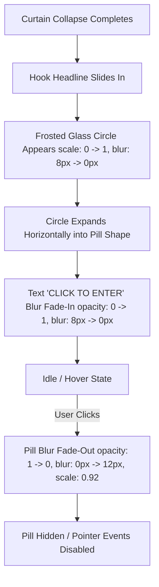

# Implementation Plan: Dimmed Oval & "Click to Enter" Animated Frosted Glass Pill

## Goal Description
Enhance the portfolio splash sequence with two visual and interactive refinements:
1. **Dim the Hook Backdrop Oval by 10%**: Soften the black gradient oval behind the headline to blend even more seamlessly into the `#09090b` background.
2. **Animated "Click to Enter" Frosted Glass Pill**:
   - Choreograph a frosted glass circle that expands into a pill shape.
   - Reveal the uppercase text `"CLICK TO ENTER"` via a blur fade-in animation.
   - Handle the click interaction by hiding the pill with a smooth blur fade-out animation (without triggering the downstream entry action yet).

---

## User Review Required

> [!IMPORTANT]
> **Oval 10% Dimmer Interpretation**:
> We will adjust the oval's opacity/alpha stops by 10% (e.g. peak opacity reduced from `0.98` to `0.88`, and intermediate stop from `0.85` to `0.76`), making the dark backdrop softer so it dissolves with zero visible boundary against `#09090b`. If you instead intended for the background layer behind the oval to be obscured 10% *more* (i.e. darker/denser black), please let us know.

> [!NOTE]
> **Placement & Layout**:
> The animated pill will be positioned in the lower third of the viewport (within the lower `flex-[1]` area of `#hero-header`), perfectly centered horizontally below the hook headline.

---

## Proposed Changes



---

### UI & Presentation Layer

#### [MODIFY] `portfolio/portfolio/index.html`
- Adjust the oval backdrop opacity by 10%:
  - Peak center: `rgba(9, 9, 11, 0.88)` (from `0.98`).
  - Mid stop: `rgba(9, 9, 11, 0.76)` (from `0.85`).
  - Outer stop: `rgba(9, 9, 11, 0.36)` (from `0.40`).
- Inside the lower spacer (`flex-[1]`):
  - Add the `#enter-pill` markup with frosted glass styling (`bg-white/[0.07]`, `border border-white/15`, `backdrop-blur-md`, `rounded-full`).
  - Add `#enter-pill-text` with `opacity: 0; filter: blur(8px);`.

```html
<!-- Inside #hero-header lower spacer -->
<div class="flex-[1] w-full min-h-4 flex items-center justify-center pointer-events-auto">
  <button
    id="enter-pill"
    type="button"
    class="enter-pill relative flex items-center justify-center overflow-hidden rounded-full border border-white/15 bg-white/[0.07] backdrop-blur-md shadow-[0_8px_32px_0_rgba(0,0,0,0.37)] cursor-pointer select-none transition-[border-color,background-color] duration-300 hover:border-white/30 hover:bg-white/[0.12] active:scale-95"
    style="width: 44px; height: 44px; opacity: 0;"
    aria-label="Click to enter"
  >
    <span
      id="enter-pill-text"
      class="whitespace-nowrap text-xs font-semibold tracking-[0.2em] uppercase text-neutral-200 select-none px-6"
      style="opacity: 0; filter: blur(8px);"
    >
      Click to enter
    </span>
  </button>
</div>
```

---

### Kinetic Engines & Controllers

#### [NEW] `portfolio/portfolio/src/engines/band/enterPill.ts`
Create a dedicated controller for the enter pill with methods:
- `animateIn()`:
  1. Circle entrance: `gsap.fromTo(pill, { width: 44, height: 44, opacity: 0, scale: 0.7, filter: 'blur(8px)' }, { opacity: 1, scale: 1.0, filter: 'blur(0px)', duration: 0.4, ease: 'power2.out' })`
  2. Pill horizontal expansion: `gsap.to(pill, { width: pillWidth, duration: 0.5, ease: 'power3.out' })`
  3. Text blur fade-in: `gsap.fromTo(text, { opacity: 0, filter: 'blur(8px)', y: 2 }, { opacity: 1, filter: 'blur(0px)', y: 0, duration: 0.45, ease: 'power2.out' })`
- `animateOut()`:
  - On click, animate out: `gsap.to(pill, { opacity: 0, filter: 'blur(12px)', scale: 0.92, duration: 0.4, ease: 'power2.in', onComplete: () => { pill.style.display = 'none'; } })`
- `bindEvents()`: Connects click listener to trigger `animateOut()`.

#### [MODIFY] `portfolio/portfolio/src/engines/band/index.ts`
- Mount `EnterPillController` when `#enter-pill` is present.
- Trigger `pillController.animateIn()` upon `onMarqueeReady` (or following the hook reveal).
- Clean up animations on `destroy()`.

---

## Verification Plan

### Automated Tests
1. **Unit Test Suite**: `portfolio/portfolio/src/engines/band/__tests__/enterPill.test.ts`
   - Verify initial styles (circle dimensions `44px`, opacity `0`).
   - Verify `animateIn()` expands to target width and unblurs text.
   - Verify click event triggers `animateOut()` with blur and opacity fade.
2. **Full Suite**:
   - `npm --prefix portfolio/portfolio test -- --run`
3. **Build**:
   - `npm --prefix portfolio/portfolio run build`

### Manual Verification
- Load page in browser:
  - Verify hook backdrop oval is softer and blends invisibly into `#09090b`.
  - Watch intro sequence: verify frosted glass circle appears, smoothly expands into a pill, and "CLICK TO ENTER" text blurs into sharp focus.
  - Hover over the pill: verify subtle frosted glass highlight.
  - Click the pill: verify it blurs and fades out cleanly without jumping or throwing errors.
