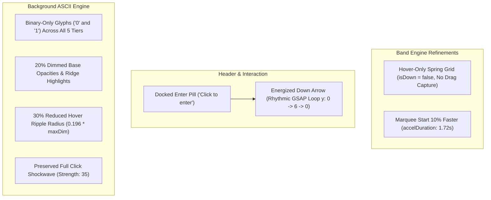

# Implementation Plan: Calibrated Band Hover, Energized Down Arrow & Binary ASCII Refinements

## Goal Description
Refine and calibrate the portfolio splash-to-band experience across three core interactive subsystems:
1. **Band Hover-Only Physics & Faster Start**:
   - Remove drag behavior from the elastic rubber band, leaving purely hover-reactive spring deformation.
   - Accelerate the band movement initiation by 10% (`accelDuration` calibrated from `1.92s` to `1.72s`).
2. **Bottom-Docked Enter Button & Energized Down Arrow**:
   - Maintain the "Click to enter" pill docked at the bottom within `#hero-header`.
   - Add a kinetic down arrow directly below the pill that executes an energized rhythmic pulsing/bounce loop (`y: 0 -> 6px -> 0`, opacity modulation `0.65 -> 1.0 -> 0.65`), prompting the user to click.
3. **Pure Binary ASCII Matrix & Visual Hierarchy**:
   - Restrict all background ASCII glyphs strictly to zeros (`0`) and ones (`1`).
   - Dim the background ASCII opacity and color intensity by 20% to shift user focus decisively toward the vermilion band.
   - Reduce the mouse hover ripple radius over the ASCII background by 30% (`0.196 * maxDim`), while preserving the full click shockwave radius and strength.

---

## User Review Required

> [!IMPORTANT]
> **Band Drag vs Hover Transition**:
> The canvas will no longer capture pointer events on `pointerdown` (`setPointerCapture` and grab cursor styling removed). The band will interact solely with hover movement. The cursor will remain default over the band, reacting fluidly to cursor speed and trajectory.

> [!NOTE]
> **Energized Down Arrow Placement**:
> The down arrow (an optical SVG chevron with 2px stroke) will be positioned directly underneath `#enter-pill` with a gap of 10px. It will animate in along with the pill, run its energized bounce loop indefinitely, and cleanly animate out and unbind on click or teardown.

---

## Proposed Changes



---

### Component 1: Presentation & DOM Shell

#### [MODIFY] [`portfolio/index.html`](file:///d:/tmp/Personal/CV/Current/Portfolio/portfolio/index.html)
- Update `#marquee-canvas` classes: replace `cursor-grab active:cursor-grabbing` with `cursor-default` to reflect hover-only behavior.
- In `#hero-header`: `#enter-pill` is maintained with generous optical margin (`mb-6 sm:mb-8 md:mb-10`) between the hook phrase and the button; down arrow removed per user directive to keep the UI strictly minimal.

---

### Component 2: Elastic Band Engine

#### [MODIFY] [`portfolio/src/engines/band/bandPhysics.ts`](file:///d:/tmp/Personal/CV/Current/Portfolio/portfolio/src/engines/band/bandPhysics.ts)
- Remove `pointerdown`, `pointerup`, and `pointercancel` listeners from `canvas`.
- In `renderFrame()`: pass `isDown = false` permanently into `grid.injectPointerForce`.
- Clean up any unused pointer capture logic and references.

#### [MODIFY] [`portfolio/src/engines/band/index.ts`](file:///d:/tmp/Personal/CV/Current/Portfolio/portfolio/src/engines/band/index.ts)
- Update `MarqueeMotionController` instantiation: set `accelDuration: 1.72` (10% faster acceleration into steady state from `1.92s`).
- Pass `arrowElement: document.getElementById('enter-arrow-container')` to `EnterPillController`.

#### [MODIFY] [`portfolio/src/engines/band/enterPill.ts`](file:///d:/tmp/Personal/CV/Current/Portfolio/portfolio/src/engines/band/enterPill.ts)
- Extend `EnterPillOptions` to accept optional `arrowElement?: HTMLElement | null`.
- Manage energized down arrow animation:
  - Initial state: `opacity: 0, y: -4`.
  - In `animateIn()`: reveal arrow simultaneously with pill text blur-in, then launch infinite bouncing loop:
    ```ts
    this.arrowLoop = gsap.to(this.arrow, {
      y: 6,
      opacity: 1,
      duration: 0.55,
      repeat: -1,
      yoyo: true,
      ease: 'power2.inOut',
    });
    ```
  - In `animateOut()`: fade out and blur/translate arrow cleanly along with the pill.
  - In `destroy()`: kill `arrowLoop` tween and reset styles.

---

### Component 3: Background ASCII Grid Engine

#### [MODIFY] [`portfolio/src/engines/background/types.ts`](file:///d:/tmp/Personal/CV/Current/Portfolio/portfolio/src/engines/background/types.ts)
- Update `TOPOGRAPHIC_TIERS`:
  - Glyphs across all tiers: set strictly to `['0', '1']`.
  - Base opacities reduced by 20%:
    - Abyss (tier 0): `0.176` (from `0.22`)
    - Slope (tier 1): `0.304` (from `0.38`)
    - Current (tier 2): `0.464` (from `0.58`)
    - Plateau (tier 3): `0.576` (from `0.72`)
    - Crest (tier 4): `0.736` (from `0.92`)

#### [MODIFY] [`portfolio/src/engines/background/asciiGrid.ts`](file:///d:/tmp/Personal/CV/Current/Portfolio/portfolio/src/engines/background/asciiGrid.ts)
- Change `DEFAULT_GLYPHS` to `['0', '1']`.
- Update ridge highlight bonus and ambient energy bonus: reduce by 20% (`ridgeBonus = cell.isRidge ? 0.128 : 0;`, `ambientEnergy * 0.096`).

#### [MODIFY] [`portfolio/src/engines/background/index.ts`](file:///d:/tmp/Personal/CV/Current/Portfolio/portfolio/src/engines/background/index.ts)
- In `boundPointerMove`: reduce hover ripple radius by an additional 40% (total reduction to ~0.1176 * maxDim):
  ```ts
  const reducedHoverRadius = (maxDim * 0.196) * 0.6; // maxDim * 0.1176 (additional 40% reduction for focused local interaction)
  this.grid.triggerShockwave(x, y, this.grid.config.mouseMoveStrength, reducedHoverRadius);
  ```
- Leave `boundPointerDown` left-click shockwave unchanged:
  ```ts
  this.grid.triggerShockwave(x, y, this.grid.config.mouseClickStrength);
  ```

---

## Strict TDD & Test Specifications

Before implementing the changes, update and write tests:

1. **`portfolio/src/engines/band/__tests__/bandPhysics.test.ts`**:
   - Test: Hover movement applies force without needing `pointerdown`.
   - Test: Canvas no longer attaches pointer capture listeners.
2. **`portfolio/src/engines/band/__tests__/enterPill.test.ts`**:
   - Test: Down arrow element animates in alongside pill.
   - Test: Down arrow launches active bouncing loop.
   - Test: Calling `destroy()` cleanly disposes the arrow animation and kills all running tweens.
3. **`portfolio/src/engines/background/__tests__/asciiGrid.test.ts`**:
   - Test: Every cell across all tiers exclusively contains `'0'` or `'1'`.
   - Test: Elevation tiers and ridge boundaries maintain dimmed 20% opacity thresholds.
   - Test: Localized hover shockwaves verify 30% reduced radius calculation.

---

## Verification Plan

### Automated Tests
```powershell
npm --prefix portfolio test
npm --prefix portfolio run build
```

### Manual Verification
1. **Band Hover**: Hover mouse cursor across the vermilion band. Observe silky smooth rubber deformation returning cleanly to equilibrium. Confirm no drag/grab cursor or pointer-capture locking occurs.
2. **Band Acceleration**: Observe the intro sequence; confirm continuous marquee movement starts 10% faster.
3. **Enter Button & Down Arrow**: Confirm "Click to enter" pill is docked at the bottom with a pulsing, energized down arrow beneath it. Click the button to confirm smooth blur fade-out.
4. **Binary ASCII**: Verify background matrix renders purely binary zeros and ones with softer (20% dimmed) opacity.
5. **Ripple Calibration**: Move cursor over background; confirm hover ripple is tight and focused (30% smaller radius). Click background; confirm full-screen punchy shockwave triggers as before.